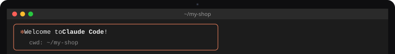
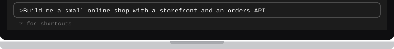

# Use Flisk with Claude Code

[← Back to the README](../../README.md#pick-your-agent)

<!-- tabs:agents claude-code · generated by scripts/docs/tabs.mjs from docs/tabs.json; edit the panel below, not the bar -->
<table>
<tr><td></td></tr>
<tr><td><a href="claude-code.md"></a><a href="codex.md"></a><a href="cursor.md"></a><a href="claude-code.md"></a></td></tr>
<tr><td>

**1. Install Claude Code and Flisk**

```bash
curl -fsSL https://claude.ai/install.sh | bash
npm install -g @flisk-sh/flisk
```

Windows: `irm https://claude.ai/install.ps1 | iex`. Also available with `brew install --cask claude-code` or `npm install -g @anthropic-ai/claude-code`.

**2. Paste the prompt**

```text
Build me a small online shop with a storefront and an orders API,
and run it on my laptop with Flisk.
```

**3. Skills and instructions.** `flisk project` writes the Flisk skills to `.claude/skills/`, which Claude Code loads. It also writes an `AGENTS.md`. Claude Code reads that only when the project has no `CLAUDE.md`, so if you have one, add the line `@AGENTS.md` to it.

**4. Optional: connect Flisk as an MCP server**, so the agent can start the stack, check status and restart services through Flisk tools instead of shell commands.

```bash
claude mcp add --scope project flisk -- flisk mcp
```

This writes `.mcp.json` in the project. Claude Code asks you to approve project servers before it uses them:

```json
{ "mcpServers": { "flisk": { "command": "flisk", "args": ["mcp"] } } }
```

Docs: [setup](https://code.claude.com/docs/en/setup) · [MCP](https://code.claude.com/docs/en/mcp) · [memory](https://code.claude.com/docs/en/memory) · [skills](https://code.claude.com/docs/en/skills)

</td></tr>
<tr><td></td></tr>
</table>
<!-- /tabs:agents -->

---

Using a different agent? Pick its tab above. Any other agent that can run terminal commands works too. Point it at `AGENTS.md`, or connect it to `flisk mcp`, which runs an MCP server over stdio.
