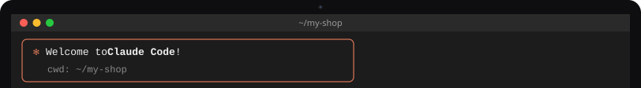

# Use Flisk with Claude Code

[← Back to the README](../../README.md#pick-your-agent)

<!-- tabs:agents claude-code · generated by scripts/docs/tabs.mjs from docs/tabs.json; edit the panel below, not the bar -->
<table>
<tr><td></td></tr>
<tr><td><a href="claude-code.md"></a><a href="codex.md"></a><a href="cursor.md"></a><a href="claude-code.md"></a></td></tr>
<tr><td>

Claude Code is an [AI helper](../start/words.md#ai-helper) made by Anthropic. It works in your [terminal](../start/words.md#terminal): you tell it in plain words what you want, and it writes the code and runs the [commands](../start/words.md#command) for you. Flisk is the tool it uses to run your app on your own computer. Never written code? [Start here](../start/first-time.md) first.

**1. Install Claude Code and Flisk**

Open your terminal, paste these two lines and press Enter. The first line installs Claude Code. The second installs Flisk with [npm](../start/words.md#npm), which needs [Node.js](../start/words.md#nodejs) on your computer. Text scrolls by while they work; they are done when you can type again.

```bash
curl -fsSL https://claude.ai/install.sh | bash
npm install -g @flisk-sh/flisk
```

Windows: `irm https://claude.ai/install.ps1 | iex`. Also available with `brew install --cask claude-code` or `npm install -g @anthropic-ai/claude-code`. These are other ways to install the same Claude Code; you need only one.

**2. Paste the prompt**

Make a folder for your app and step into it with `mkdir my-shop && cd my-shop`. Then type `claude` and press Enter to start Claude Code (the first time, it asks you to sign in). Paste this [prompt](../start/words.md#prompt) and press Enter:

```text
Build me a small online shop with a storefront and an orders API,
and run it on my laptop with Flisk.
```

What you will see: Claude Code writes the files and runs the Flisk commands, one step at a time. It may ask before it runs a command or changes a file; read what it wants to do and say yes if it looks right. When your app is running, Flisk prints links to open in your web browser. They point to [localhost](../start/words.md#localhost), your own computer, so only you can see the shop. If something does not work, ask Claude Code to run [`flisk doctor`](../start/words.md#flisk-doctor).

**3. Skills and instructions.** Nothing to do here for a new project. When the agent sets up your project with `flisk project`, Flisk also leaves notes in it that teach the agent how to use Flisk.

**For developers:** `flisk project` writes the Flisk skills to `.claude/skills/`, which Claude Code loads. It also writes an `AGENTS.md`. Claude Code reads that only when the project has no `CLAUDE.md`, so if you have one, add the line `@AGENTS.md` to it.

**4. Optional: connect Flisk as an MCP server**, so the agent can start the stack, check status and restart services through Flisk tools instead of shell commands.

You can skip this step: everything above works without it. With [MCP](../start/words.md#mcp), Claude Code starts, checks and restarts your app with Flisk's own tools instead of typing commands. To turn it on, run this in your project folder:

```bash
claude mcp add --scope project flisk -- flisk mcp
```

This writes `.mcp.json` in the project. Claude Code asks you to approve project servers before it uses them:

```json
{ "mcpServers": { "flisk": { "command": "flisk", "args": ["mcp"] } } }
```

Docs: [setup](https://code.claude.com/docs/en/setup) · [MCP](https://code.claude.com/docs/en/mcp) · [memory](https://code.claude.com/docs/en/memory) · [skills](https://code.claude.com/docs/en/skills)

</td></tr>
<tr><td></td></tr>
</table>
<!-- /tabs:agents -->

---

Using a different AI helper? Pick its tab above. Any other agent that can run terminal commands works too. Point it at `AGENTS.md` (the instructions file Flisk writes for agents), or connect it to `flisk mcp`, which runs an MCP server over stdio.
