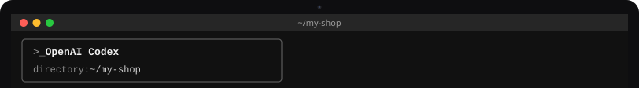

# Use Flisk with Codex

[← Back to the README](../../README.md#pick-your-agent)

<!-- tabs:agents codex · generated by scripts/docs/tabs.mjs from docs/tabs.json; edit the panel below, not the bar -->
<table>
<tr><td></td></tr>
<tr><td><a href="claude-code.md"></a><a href="codex.md"></a><a href="cursor.md"></a><a href="codex.md"></a></td></tr>
<tr><td>

Codex is an [AI helper](../start/words.md#ai-helper) made by OpenAI. It works in your [terminal](../start/words.md#terminal): you tell it in plain words what you want, and it writes the code and runs the [commands](../start/words.md#command) for you. Flisk is the tool it uses to run your app on your own computer. Never written code? [Start here](../start/first-time.md) first.

**1. Install Codex and Flisk**

Open your terminal, paste these two lines and press Enter. The first line installs Codex, the second installs Flisk. Both use [npm](../start/words.md#npm), which needs [Node.js](../start/words.md#nodejs) on your computer. Text scrolls by while they work; they are done when you can type again.

```bash
npm install -g @openai/codex
npm install -g @flisk-sh/flisk
```

Also available with `curl -fsSL https://chatgpt.com/codex/install.sh | sh` or `brew install --cask codex`. These are other ways to install the same Codex; you need only one.

**2. Paste the prompt**

Make a folder for your app and step into it with `mkdir my-shop && cd my-shop`. Then type `codex` and press Enter to start Codex (the first time, it asks you to sign in). Paste this [prompt](../start/words.md#prompt) and press Enter:

```text
Build me a small online shop with a storefront and an orders API,
and run it on my laptop with Flisk.
```

What you will see: Codex writes the files and runs the Flisk commands, one step at a time. It may ask before it runs a command; read what it wants to do and say yes if it looks right. When your app is running, Flisk prints links to open in your web browser. They point to [localhost](../start/words.md#localhost), your own computer, so only you can see the shop. If something does not work, ask Codex to run [`flisk doctor`](../start/words.md#flisk-doctor).

**3. Skills and instructions.** Nothing to do here for a new project. When the agent sets up your project with `flisk project`, Flisk also leaves notes in it that teach the agent how to use Flisk.

**For developers:** Codex reads the `AGENTS.md` and the skills in `.agents/skills/` that `flisk project` writes.

**4. Optional: connect Flisk as an MCP server**, so the agent can start the stack, check status and restart services through Flisk tools instead of shell commands.

You can skip this step: everything above works without it. With [MCP](../start/words.md#mcp), Codex starts, checks and restarts your app with Flisk's own tools instead of typing commands. To turn it on, run this in your terminal:

```bash
codex mcp add flisk -- flisk mcp
```

Or add it by hand to `~/.codex/config.toml`. A project `.codex/config.toml` works for trusted projects:

```toml
[mcp_servers.flisk]
command = "flisk"
args = ["mcp"]
```

Docs: [CLI](https://learn.chatgpt.com/docs/codex/cli.md) · [MCP](https://learn.chatgpt.com/docs/extend/mcp?surface=cli) · [AGENTS.md](https://learn.chatgpt.com/docs/agent-configuration/agents-md.md) · [skills](https://learn.chatgpt.com/docs/build-skills.md)

</td></tr>
<tr><td></td></tr>
</table>
<!-- /tabs:agents -->

---

Using a different AI helper? Pick its tab above. Any other agent that can run terminal commands works too. Point it at `AGENTS.md` (the instructions file Flisk writes for agents), or connect it to `flisk mcp`, which runs an MCP server over stdio.
