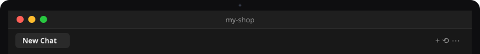

# Use Flisk with Cursor

[← Back to the README](../../README.md#pick-your-agent)

<!-- tabs:agents cursor · generated by scripts/docs/tabs.mjs from docs/tabs.json; edit the panel below, not the bar -->
<table>
<tr><td></td></tr>
<tr><td><a href="claude-code.md"></a><a href="codex.md"></a><a href="cursor.md"></a><a href="cursor.md"></a></td></tr>
<tr><td>

Cursor is an app for writing code with an [AI helper](../start/words.md#ai-helper) built in. You type what you want into its agent chat, in plain words, and it writes the code and runs the [commands](../start/words.md#command) for you. Flisk is the tool it uses to run your app on your own computer. Never written code? [Start here](../start/first-time.md) first.

**1. Install Cursor and Flisk**

Install the [Cursor editor](https://cursor.com), or the Cursor CLI:

```bash
curl https://cursor.com/install -fsS | bash
npm install -g @flisk-sh/flisk
```

If you are new to this, start with the editor: download it from the link and install it like any other app. The first line above installs the Cursor CLI instead, a version of Cursor that works in the [terminal](../start/words.md#terminal); with the editor you can skip it. The second line installs Flisk with [npm](../start/words.md#npm), which needs [Node.js](../start/words.md#nodejs) on your computer. Paste it into a terminal and press Enter; it is done when you can type again.

**2. Paste the prompt**

Open a folder for your app in Cursor (an empty one is fine), open the agent chat and paste this [prompt](../start/words.md#prompt):

```text
Build me a small online shop with a storefront and an orders API,
and run it on my laptop with Flisk.
```

What you will see: the agent writes the files and runs the Flisk commands, one step at a time. It may ask before it runs a command; read what it wants to do and say yes if it looks right. When your app is running, Flisk prints links to open in your web browser. They point to [localhost](../start/words.md#localhost), your own computer, so only you can see the shop. If something does not work, ask the agent to run [`flisk doctor`](../start/words.md#flisk-doctor).

**3. Skills and instructions.** Nothing to do here for a new project. When the agent sets up your project with `flisk project`, Flisk also leaves notes in it that teach the agent how to use Flisk.

**For developers:** Cursor reads the `AGENTS.md` and the skills in `.agents/skills/` (and `.claude/skills/`) that `flisk project` writes.

**4. Optional: connect Flisk as an MCP server**, so the agent can start the stack, check status and restart services through Flisk tools instead of shell commands.

You can skip this step: everything above works without it. With [MCP](../start/words.md#mcp), the agent starts, checks and restarts your app with Flisk's own tools instead of typing commands.

The quickest way: [Add to Cursor](https://cursor.com/en/install-mcp?name=flisk&config=eyJjb21tYW5kIjoiZmxpc2siLCJhcmdzIjpbIm1jcCJdfQ==) opens Cursor and asks you to add the Flisk server. Or create `.cursor/mcp.json` in the project (or `~/.cursor/mcp.json` for every project):

```json
{ "mcpServers": { "flisk": { "type": "stdio", "command": "flisk", "args": ["mcp"] } } }
```

Docs: [CLI install](https://cursor.com/docs/cli/installation) · [MCP](https://cursor.com/docs/context/mcp) · [rules](https://cursor.com/docs/context/rules) · [skills](https://cursor.com/docs/context/skills)

</td></tr>
<tr><td></td></tr>
</table>
<!-- /tabs:agents -->

---

Using a different AI helper? Pick its tab above. Any other agent that can run terminal commands works too. Point it at `AGENTS.md` (the instructions file Flisk writes for agents), or connect it to `flisk mcp`, which runs an MCP server over stdio.
