<!-- Generated by scripts/docs/fit.mjs; edit the generator, not this page. -->
# Is Flisk right for your team?

[← Back to the README](../../README.md#is-flisk-right-for-your-team)

**Your answers:** Go · Docker Compose · 1 part. Click a tab to change one; the score updates.

<table>
<tr><td><b>1. What is the app written in?</b> </td></tr>
<tr><td><b>2. How do developers start the app on their laptop today?</b> </td></tr>
<tr><td><b>3. How many parts does the app have? (website, API, background jobs, …)</b> </td></tr>
</table>

**Not a fit yet.** Your team does not have the problem Flisk solves, yet.

- ✅ Flisk can create Go parts for you (`flisk resource … --language go`).
- ✅ Your team already uses containers. Flisk writes those setup files for them and keeps them in sync.
- ✅ New developers start with two commands (`flisk doctor`, `flisk up`) instead of a long setup guide. Not yet timed with real new hires.
- ✅ Every laptop gets the same base setup, so "it works on my machine" happens less.
- ❌ One part does not need Flisk. It pays off from about 5 parts.
- ✅ The score assumes a team of 10 developers. It is simple math on your answers, not measured savings.

**How the score adds up**

| | Your answer | Points |
| --- | --- | --- |
| Language | Go | 18 / 20 |
| How you start it today | Docker Compose | 16 / 20 |
| Pains (we assumed) | Slow onboarding, laptops that differ | 12 / 24 |
| Parts | 1 part | 4 / 20 |
| Team size (we assumed) | 10 developers | 14 / 16 |
| Sum | | 64 / 100 |
| **Cap** | Only one part: Flisk is for apps with several parts, so the score stops at 40%. | **40** |
| **Score** | | **40%** |

Same math as [flisk.sh/fit](https://flisk.sh/fit/). Two things have no tabs here, so we assumed them (marked "we assumed"); change them on the website. The score never says "great fit" when a reason above says otherwise.

**Next:** [see what Flisk generates](../generated-files.md), or [run your services without Docker](../run-without-docker.md).
