<!-- Generated by scripts/docs/fit.mjs; edit the generator, not this page. -->
# Does Flisk fit your stack?

[← Back to the README](../../README.md#does-flisk-fit-your-stack)

**Your answers:** Node.js / TypeScript / Bun · Cloud IDE (Gitpod / Codespaces / Coder) · 2–4 services. Click a tab to change one; the score follows.

<table>
<tr><td><b>1. Primary runtime</b> </td></tr>
<tr><td><b>2. How do you run things locally today?</b> </td></tr>
<tr><td><b>3. Services running at once</b> </td></tr>
</table>

**Partial fit.** Flisk will help; read the caveats below first.

- ✅ Built for it: the generated services and golden images are TypeScript and Bun first (Vite, Prisma).
- 🟡 Cloud IDEs solve a different problem; Flisk runs the same stack on your own machine, with no per-seat bill.
- ✅ `flisk doctor` and `flisk up` are designed to replace a setup wiki. Onboarding time has not been measured on a hiring cohort.
- ✅ Golden Docker L1–L4 image layers give every developer the same base images.
- 🟡 A few services already benefit, but the sweet spot is 5 or more.
- ✅ The score assumes 10 developers. It is arithmetic on your answers, not measured savings.

The score is the one on [flisk.sh/fit](https://flisk.sh/fit/): 2 × runtime + 2 × setup + pains + services + team, out of 100. Pains and team size have no tabs here; they stay at the website's defaults (onboarding and environment drift, 10 developers). Change them on the website.

**Next:** [install Flisk](../install/npm.md) and [pick how to start](../../README.md#quick-start).
