<!-- Generated by scripts/docs/fit.mjs; edit the generator, not this page. -->
# Is Flisk right for your team?

[← Back to the README](../../README.md#is-flisk-right-for-your-team)

**Your answers:** JavaScript or TypeScript (Node.js, Bun) · A cloud workspace in the browser (Codespaces, Gitpod, Coder) · 5 or more parts. Click a tab to change one; the score updates.

<table>
<tr><td><b>1. What is the app written in?</b> </td></tr>
<tr><td><b>2. How do developers start the app on their laptop today?</b> </td></tr>
<tr><td><b>3. How many parts does the app have? (website, API, background jobs, …)</b> </td></tr>
</table>

**Great fit.** Flisk was made for teams like yours.

- ✅ Flisk is made for JavaScript and TypeScript apps first.
- 🟡 Cloud workspaces run in the browser and are paid per person. Flisk runs the same app on each laptop, and the Flisk CLI is free.
- ✅ New developers start with two commands (`flisk doctor`, `flisk up`) instead of a long setup guide. Not yet timed with real new hires.
- ✅ Every laptop gets the same base setup, so "it works on my machine" happens less.
- ✅ 5 or more parts is what Flisk is for. Our tests start 100 small test parts at once (test stubs, not a real app).
- ✅ The score assumes a team of 10 developers. It is simple math on your answers, not measured savings.

**How the score adds up**

| | Your answer | Points |
| --- | --- | --- |
| Language | JavaScript or TypeScript (Node.js, Bun) | 20 / 20 |
| How you start it today | A cloud workspace in the browser (Codespaces, Gitpod, Coder) | 10 / 20 |
| Pains (we assumed) | Slow onboarding, laptops that differ | 12 / 24 |
| Parts | 5 or more parts | 20 / 20 |
| Team size (we assumed) | 10 developers | 14 / 16 |
| **Score** | | **76%** |

Same math as [flisk.sh/fit](https://flisk.sh/fit/). Two things have no tabs here, so we assumed them (marked "we assumed"); change them on the website. The score never says "great fit" when a reason above says otherwise.

**Next:** [install Flisk](../install/npm.md) and [pick how to start](../../README.md#quick-start).
