<!-- Generated by scripts/docs/fit.mjs; edit the generator, not this page. -->
# Does Flisk fit your stack?

[← Back to the README](../../README.md#does-flisk-fit-your-stack)

**Your answers:** Python · A mix of scripts, containers and manual steps · 5+ services. Click a tab to change one; the score follows.

<table>
<tr><td><b>1. Primary runtime</b> </td></tr>
<tr><td><b>2. How do you run things locally today?</b> </td></tr>
<tr><td><b>3. Services running at once</b> </td></tr>
</table>

**Strong fit.** Flisk was built for exactly this setup.

- ✅ `flisk resource api --type backend --language python` scaffolds a Python backend; see the [one-backend-python example](../../examples/one-backend-python/README.md).
- ✅ A different setup on every machine is the drift one `service.json` per service removes.
- ✅ `flisk doctor` and `flisk up` are designed to replace a setup wiki. Onboarding time has not been measured on a hiring cohort.
- ✅ Golden Docker L1–L4 image layers give every developer the same base images.
- ✅ 5 or more services is Flisk's range. CI boots 100 generated `/health` services through one gateway (a fixture, not an app).
- ✅ The score assumes 10 developers. It is arithmetic on your answers, not measured savings.

**How the score adds up**

| | Your answer | Points |
| --- | --- | --- |
| Runtime | Python | 18 / 20 |
| Today's setup | A mix of scripts, containers and manual steps | 18 / 20 |
| Pains (assumed) | Onboarding, environment drift | 12 / 24 |
| Services | 5+ services | 20 / 20 |
| Team (assumed) | 10 developers | 14 / 16 |
| **Score** | | **82%** |

Same formula as [flisk.sh/fit](https://flisk.sh/fit/). Pains and team size have no tabs here, so they stay at the website's defaults (marked assumed); change them on the website. The caps keep the verdict in line with the reasons.

**Next:** [install Flisk](../install/npm.md) and [pick how to start](../../README.md#quick-start).
