# Set up macOS for Flisk

[← Back to the README](../../README.md#prerequisites-install-once)

<!-- tabs:setup macos · generated by scripts/docs/tabs.mjs from docs/tabs.json; edit the panel below, not the bar -->
<table>
<tr><td></td></tr>
<tr><td><a href="macos.md"></a><a href="linux.md"></a><a href="windows.md"></a><a href="omarchy.md"></a><a href="macos.md"></a></td></tr>
<tr><td>

Get your Mac ready for Flisk. You do this once. Every grey box below is a [command](../start/words.md#command): copy it, paste it into the [terminal](../start/words.md#terminal) and press Enter. To open the terminal, press Cmd+Space, type `Terminal` and press Enter. Never written code? [Start here](../start/first-time.md).

**1. Node.js 22.12 or newer** from [nodejs.org](https://nodejs.org/). [Node.js](../start/words.md#nodejs) is a free program that Flisk runs on: download it and install it like any other app. If your app is written in something else, such as Python, install that too. For a small app, that is all you need: the [simplest path](../start/simplest.md) runs each [part of your app](../start/words.md#app-parts) as a normal program on your Mac.

**For developers:** the simplest path needs only Node.js and your app's own runtime; your services run as local processes.

**2. Only for bigger apps: Docker and Tilt.** You need these when your app has a [database](../start/words.md#database), one web address in front of all its parts (a gateway URL), or must run in the same [container](../start/words.md#container) you deploy. Then also start a container runtime and install Tilt 0.25+:

- [Docker](../start/words.md#docker): install and start Docker Desktop, OrbStack or Colima (Docker Engine 25+, Compose 2.20.2+)
- [Tilt](../start/words.md#tilt): paste this command, which downloads and installs it:

```bash
curl -fsSL https://raw.githubusercontent.com/tilt-dev/tilt/master/scripts/install.sh \
  | bash
```

**3. Install Flisk and check your Mac:**

```bash
npm install -g @flisk-sh/flisk
flisk doctor
```

The first line [installs](../start/words.md#install) Flisk with [npm](../start/words.md#npm), which came with Node.js. The second, [`flisk doctor`](../start/words.md#flisk-doctor), checks only what your project uses and prints a fix for anything missing. To check that Flisk itself is installed, run `flisk --version`: it prints a version number.

Rather not install Node.js? [Install the prebuilt binary](../install/binary.md) instead: it needs nothing else.

</td></tr>
<tr><td></td></tr>
</table>
<!-- /tabs:setup -->

---

On Ubuntu, Windows or Omarchy? Pick its tab above.
