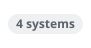

# Set up Omarchy for Flisk

[← Back to the README](../../README.md#prerequisites-install-once)

<!-- tabs:setup omarchy · generated by scripts/docs/tabs.mjs from docs/tabs.json; edit the panel below, not the bar -->
<table>
<tr><td></td></tr>
<tr><td><a href="macos.md"></a><a href="linux.md"></a><a href="windows.md"></a><a href="omarchy.md"></a><a href="omarchy.md"></a></td></tr>
<tr><td>

[Omarchy](https://omarchy.org/) is Arch Linux with Hyprland, so the usual Arch packages work. Run these in a terminal.

**1. Node.js 22.12 or newer**, plus your app's own runtime. That is all the [simplest path](../start/simplest.md) needs: your services run as local processes.

```bash
sudo pacman -S --needed nodejs npm
```

**2. For a database, one gateway URL and the same container you deploy**, you also need Docker and Tilt. Check Docker with `docker info`. If it is missing:

```bash
sudo pacman -S --needed docker docker-compose
sudo systemctl enable --now docker.service
```

To run `docker` without `sudo`, follow Docker's [post-install steps](https://docs.docker.com/engine/install/linux-postinstall/). Then install Tilt 0.25+:

```bash
curl -fsSL https://raw.githubusercontent.com/tilt-dev/tilt/master/scripts/install.sh \
  | bash
```

**3. Install Flisk and check the machine:**

```bash
npm install -g @flisk-sh/flisk
flisk doctor
```

`flisk doctor` checks only what your project uses and prints a fix for anything missing. No Node.js? [Install the prebuilt binary](../install/binary.md) instead.

</td></tr>
<tr><td></td></tr>
</table>
<!-- /tabs:setup -->

---

On macOS, Ubuntu or Windows? Pick its tab above.
