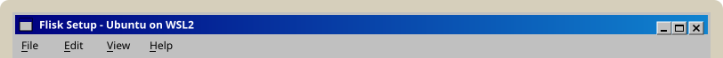
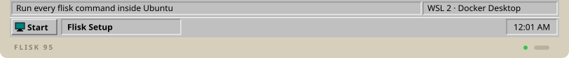

# Set up Windows for Flisk (WSL2)

[← Back to the README](../../README.md#prerequisites-install-once)

<!-- tabs:setup windows · generated by scripts/docs/tabs.mjs from docs/tabs.json; edit the panel below, not the bar -->
<table>
<tr><td></td></tr>
<tr><td><a href="macos.md"></a><a href="linux.md"></a><a href="windows.md"></a><a href="omarchy.md"></a><a href="windows.md"></a></td></tr>
<tr><td>

Flisk runs on Windows inside **Ubuntu on WSL2**. Native Windows runs only inspection commands (`flisk --version`, `flisk doctor`, `flisk up --dry-run`); `flisk up` there refuses and points to WSL2.

**1. Install Ubuntu on WSL2.** In PowerShell:

```powershell
wsl --install -d Ubuntu
```

**2. For a database, one gateway URL and the same container you deploy**, install [Docker Desktop](https://www.docker.com/products/docker-desktop/) with the WSL 2 backend. In Docker Desktop, open **Settings → Resources → WSL Integration**, turn it on for Ubuntu, and click **Apply & Restart**.

**3. In the Ubuntu terminal**, install Tilt and Flisk, then check the machine:

```bash
curl -fsSL https://raw.githubusercontent.com/tilt-dev/tilt/master/scripts/install.sh \
  | bash
curl -fsSL https://flisk.sh/install.sh | sh
flisk doctor
```

Run every Flisk command from Ubuntu, not from PowerShell. The [Windows & WSL2 guide](../wsl2.md) has the full walkthrough, an example stack and troubleshooting.

</td></tr>
<tr><td></td></tr>
</table>
<!-- /tabs:setup -->

---

On macOS, Ubuntu or Omarchy? Pick its tab above.
